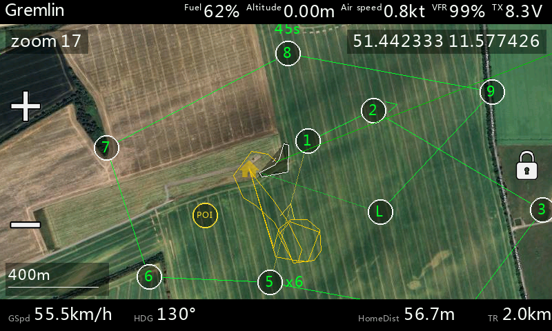

# Widget Overview

This guide describes the user interface of the ETHOS Mapping Widget: what you see on screen, how to interact with it, and how to configure it.

> Screenshots below may not reflect the latest version. They will be updated over time.

## Map Screen

The map screen is the main view of the widget. It shows a live satellite map centered on your UAV position with telemetry information and on-screen controls.

### Top Bar

The top bar displays:

- **Model name** (left) — your ETHOS model name
- **Custom telemetry sensors** (right) — up to 3 user-configurable sensors plus a dedicated link quality / RSSI slot and the transmitter voltage

The sensors shown in the top bar are assigned in the widget settings (see [Settings](#settings) below).

### Bottom Bar

The bottom bar shows calculated values derived from GPS telemetry:

| Label      | Description                              |
|------------|------------------------------------------|
| **GSpd**   | Ground speed                             |
| **HDG**    | Heading / course over ground in degrees  |
| **HomeDist** | Distance to home position              |
| **TR**     | Total distance travelled since the widget started |

Units are configurable in the widget settings.

### On-Screen Controls

| Control    | Location     | Function                                             |
|------------|--------------|------------------------------------------------------|
| **+** button | Left edge, upper | Zoom in                                         |
| **−** button | Left edge, lower | Zoom out                                        |
| **Lock** button | Right edge, middle (fullscreen only) | Toggle follow-lock (map tracks UAV or stays detached) |
| **Pin** button | Right edge, upper (fullscreen, unlocked only) | Place or remove an observation marker at the crosshair |

The zoom buttons are hidden when zoom is controlled by an RC channel (*Zoom control* setting).
The current zoom level is shown in the top-left corner of the map. Tapping + or − at the zoom limit briefly shows "ZOOM LIMIT".

### Map Elements

- **UAV icon** — shows the vehicle's current position and heading. Three symbol styles are available: Arrow, Airplane, and Multirotor (configurable in settings). The UAV symbol turns **red** when GPS telemetry is lost (no position update for 5 seconds).
- **Home marker** — small orange house icon at the home position (set automatically on arming — detected via MSP or a switch, see *Home set trigger* — or manually via menu).
- **Edge arrows** — when an object is outside the visible map, an arrow at the map edge points toward it: yellow = home, red = UAV (while panned away), orange/red = ADS-B contact.
- **ADS-B contact** (experimental) — the aircraft INAV warns about, if *ADS-B Alert* is enabled: arrow in its flight direction with callsign, distance and altitude (MSL).
- **Trail** — a yellow line tracing the flight path. Trail resolution and bend sensitivity are configurable.
- **Scale bar** — bottom-left corner, shows the current map scale.
- **GPS coordinates** — displayed on screen in decimal or DMS format (configurable). The overlay turns **red** when GPS telemetry is lost.
- **Observation marker** — a user-placed pin for marking a point of interest on the map.
- **Waypoint overlay** — INAV mission waypoints and flight path, if waypoint download is enabled (see [Waypoint Mission](WaypointMission.md)).

### Map Panning (Fullscreen Only)

In fullscreen mode, you can drag the map to explore the area around the UAV. The map enters detached mode and stops following the aircraft. After releasing, the map holds position briefly before re-centering.

For full details, see [Panning & Observation Marker](PanningAndMarker.md).

### Split-Screen and Small Widgets

The widget adapts to any size. In smaller widget sizes, the top and bottom bars are automatically hidden to maximize map area. On-screen buttons scale down accordingly.

## Context Menu

Long-press the widget to open its context menu. Available actions depend on whether a GPS position is available:

| Action                    | Description                                                  |
|---------------------------|--------------------------------------------------------------|
| **Maps: Reset**           | Clears the trail, reloads the layout and re-downloads waypoints |
| **Maps: Set Home**        | Sets the home position to the current UAV location           |
| **Maps: Set Default Position** | Saves the current position as the default map center when no GPS is available |
| **Maps: Zoom in**         | Increase zoom level by one step                              |
| **Maps: Zoom out**        | Decrease zoom level by one step                              |

> Without a GPS position only **Maps: Reset** is shown. The zoom entries are hidden when zoom is controlled proportionally by an RC channel.

## Map Providers and Types

The widget supports multiple map tile providers. Available providers and map types depend on which tiles you have downloaded to the SD card.

| Provider   | Map Types Available           |
|------------|-------------------------------|
| **GMapCatcher (Yaapu)** | Satellite, Hybrid, Map, Terrain (Yaapu/GMapCatcher tile folders) |
| **Google** | Map, Satellite, Hybrid, Terrain |
| **ESRI**   | Satellite, Hybrid, Street     |
| **OSM**    | Street                        |
| **MapTiler** | Satellite, Hybrid, Street, Outdoor, Topo, Winter, OSM Style |

Only providers and map types with tiles on the SD card are offered. Existing Yaapu Google tiles are also used automatically as fallback for the Google provider — see the [Map Tiles Guide](MapTilesGuide.md).

### Missing Tiles

When tiles are not available for the current area or zoom level, a "NO MAP DATA" placeholder is shown in place of the missing tiles.

## Settings

Open the widget settings through the ETHOS screen and widget configuration of your model (on ETHOS 26.x: press **DISP** and use the widget manager). The exact steps depend on the ETHOS version — see the ETHOS documentation on widgets. All settings are saved per widget instance.

### Map Settings

| Setting           | Description                                      | Default     |
|-------------------|--------------------------------------------------|-------------|
| Map provider      | Tile provider (GMapCatcher, Google, ESRI, OSM, MapTiler) | Google |
| Map type          | Map type for the selected provider               | Satellite   |
| Map zoom max      | Maximum allowed zoom level                       | 20          |
| Map zoom min      | Minimum allowed zoom level                       | 1           |

The zoom range is automatically narrowed to the zoom levels present in your tile folders. The
widget starts with the zoom level you used last.

### Features

| Setting                  | Description                                                                                | Default |
|--------------------------|--------------------------------------------------------------------------------------------|---------|
| Waypoint download (INAV) | Automatically download and display INAV missions via MSP (SmartPort, Crossfire, ELRS)      | On      |
| ADS-B Alert (experimental, INAV 10) | Shows only the aircraft INAV flags as ADS-B warning/alert — no general traffic picture (FC with ADS-B receiver, INAV 10 or newer): heading arrow with callsign, distance and altitude (MSL), orange = warning, red = alert, edge arrow when off-screen, sound + vibration when the threat level rises. Warning/alert distances come from the INAV OSD settings. On older INAV the feature switches itself off for the session | Off |
| Home set trigger         | How home is set automatically: **MSP arming (INAV)** — the FC reports armed (polled every 5 s), or **Switch** — the selected switch position becomes active. With *Switch*, MSP arming is ignored for home | MSP arming |
| Home set switch          | Switch position that sets home, typically your arming switch (only when the trigger is *Switch*). Home is set on the moment the switch becomes active and only with a valid GPS position; without GPS fix, home stays empty until the next off→on or a manual Set Home | — |
| Zoom control             | Control zoom via RC channel: Off, 3-Position switch, or Proportional                       | Off     |
| Zoom channel             | RC channel number (1–64) for zoom input (only when zoom control is enabled)                | 0       |

### Top Bar Telemetry

| Setting              | Description                                                   | Default |
|----------------------|---------------------------------------------------------------|---------|
| Link quality source  | Telemetry source for LQ/RSSI display in the top bar           | —       |
| User sensor 1        | Custom telemetry source shown in the top bar                  | —       |
| User sensor 2        | Custom telemetry source shown in the top bar                  | —       |
| User sensor 3        | Custom telemetry source shown in the top bar                  | —       |

### Units

| Setting                   | Options                    | Default |
|---------------------------|----------------------------|---------|
| Airspeed/Groundspeed unit | m/s, km/h, mph, kn         | m/s     |
| Vertical speed unit       | m/s, ft/s, ft/min          | m/s     |
| Altitude/Distance unit    | m, ft                      | m       |
| Long distance unit        | km, mi                     | km      |
| GPS coordinates format    | DMS, Decimal               | Decimal |

### Display

| Setting              | Options                         | Default |
|----------------------|---------------------------------|---------|
| Vehicle symbol       | Arrow, Airplane, Multirotor     | Arrow   |
| Trail resolution     | Off, 20m, 50m, 100m, 500m, 1km  | 50m     |
| Trail bend threshold | 3–15 degrees                    | 5°      |

### Telemetry Source

| Setting              | Description                                                         | Default |
|----------------------|---------------------------------------------------------------------|---------|
| Telemetry source     | ETHOS (built-in GPS) or Sensors (user-assigned sources)             | ETHOS   |
| GPS Lat source       | Source for GPS latitude (Sensors mode only)                         | —       |
| GPS Lon source       | Source for GPS longitude (Sensors mode only)                        | —       |
| Heading source       | Optional heading/yaw source (Sensors mode only)                     | —       |
| Speed source         | Optional ground speed source (Sensors mode only)                    | —       |

> Sensors mode is intended for advanced setups where the default ETHOS GPS source is not suitable.
> In both modes, implausible GPS jumps (cold-start garbage) are filtered; a new position is accepted once it has been consistent for about 3 seconds.

### Debug & Developer

| Setting              | Description                                                  | Default |
|----------------------|--------------------------------------------------------------|---------|
| Enable debug log     | Writes a debug log to the SD card during runtime             | Off     |
| Enable perf profile  | Emits 5-second performance summaries into the debug log      | Off     |

These options are for troubleshooting and development only. They increase SD card writes and should be disabled during normal use.
